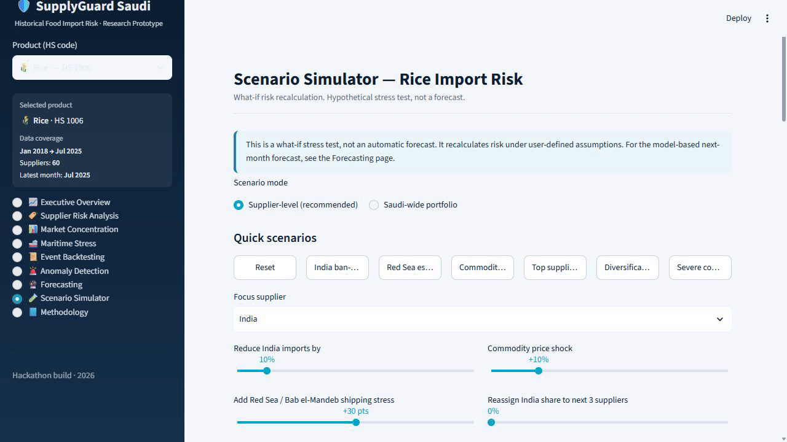

# SupplyGuard Saudi

[](https://github.com/NaderAljohani/supplyguard/actions/workflows/ci.yml)

SupplyGuard analyses Saudi food-import exposure using a composite
risk index. It combines supplier dependency, market concentration, import
changes, commodity prices, logistics performance, and maritime stress for rice,
wheat, barley, maize, and sugar.



Ten-second walkthrough of the running scenario simulator using the bundled
historical snapshot and the Red Sea escalation preset. It shows hypothetical
index changes under the selected assumptions.

The Streamlit dashboard separates the historical index, anomaly detection,
experimental next-month index forecasting, and deterministic scenario analysis.
It runs without API credentials.

## Run the dashboard

Use Python 3.13. The repository includes a historical input and dashboard-output
snapshot, so model training is not required to open the app.

```bash
python -m venv .venv
# Windows PowerShell: .venv\Scripts\Activate.ps1
# macOS/Linux: source .venv/bin/activate
python -m pip install -r requirements-lock.txt
python -m streamlit run app/streamlit_app.py
```

To regenerate processed data, evaluation tables, and figures:

```bash
python run_pipeline.py
python scripts/update_data_manifest.py
```

The default pipeline compares persistence, linear regression, random forest,
and histogram gradient boosting. XGBoost is an optional alternative. Optional
Gemini text recommendations require the extra dependencies in
`requirements-optional.txt` and your own `.env`; calls occur only when requested
in the scenario page. Numerical scores are computed locally. Live AI calls were
not part of the offline verification.

## Dashboard

| View | Purpose |
|---|---|
| Executive overview | Product snapshot and supplier exposure |
| Supplier risk analysis | Historical drivers and component contributions |
| Market concentration | Supplier shares, HHI, and top-three concentration |
| Maritime stress | Port and chokepoint context |
| Event backtesting | Descriptive before/after views around curated annotations |
| Anomaly detection | Unusual observations, separate from disruption labels |
| Forecasting | Experimental next-month composite-index estimates |
| Scenario simulator | Deterministic changes under user-supplied shocks |
| Methodology | Weights, data quality, sensitivity, and limitations |

## Method

The analytical grain is product, supplier, and calendar month. The index is a
weighted sum of six 0-to-100 components:

| Component | Weight |
|---|---:|
| Supplier dependency | 20% |
| Market concentration | 15% |
| Import anomaly | 20% |
| Commodity price stress | 15% |
| Logistics risk | 10% |
| Maritime shipping stress | 20% |

The methodology defines the index weights and thresholds as modelling assumptions. Scenario outputs are
recomputed index values, not predictions of commercial losses or causal effects.

Forecast models are selected on an earlier three-target-month validation
window, including persistence as a candidate. The last six available target
months are reserved for evaluation. Calendar gaps remain missing, rather than
being treated as consecutive months. A separate refit on known history produces
the snapshot forecasts. See [evaluation results](docs/EVALUATION.md).

## Data and limits

The dashboard analyses historical data: trade coverage spans 2018 to July 2025,
and maritime coverage differs. The dataset has no verified disruption labels.
The forecast target is the next
index value, not the probability of disruption. Results vary by product and
some evaluation samples are very small. Event comparisons establish no causal
effect or warning lead time. Input publication lags are not fully modelled.

Source families are UN Comtrade, World Bank commodity prices and LPI, and IMF
PortWatch. The repository uses supplied derived extracts rather than an
automated connection to those services. Source and redistribution boundaries
are documented in [data notes](docs/DATA.md) and
[license status](LICENSE_NOTICE.md).

## Verify

```bash
python scripts/check_release.py
python -m pytest -q
```

Tests cover forecasting boundaries, missing calendar months, baseline selection,
multi-product event filtering, optional AI fallback, and dashboard views.
The linked CI runs release checks and tests on Windows and Linux.

## Design choices

The index, anomaly flags, forecasts, and scenario outputs are presented
separately because each answers a different question. Forecast selection
includes persistence so a trained model must compete with carrying the latest
value forward. Scenario calculations run locally; optional model-generated
text explains results without setting the numerical scores.

[الدليل العربي](README_AR.md) | [Preparation changes](docs/PREPARATION.md)
